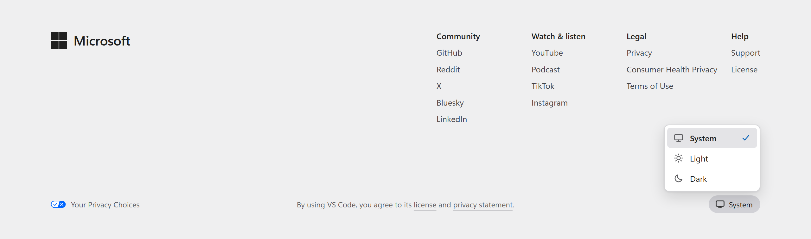
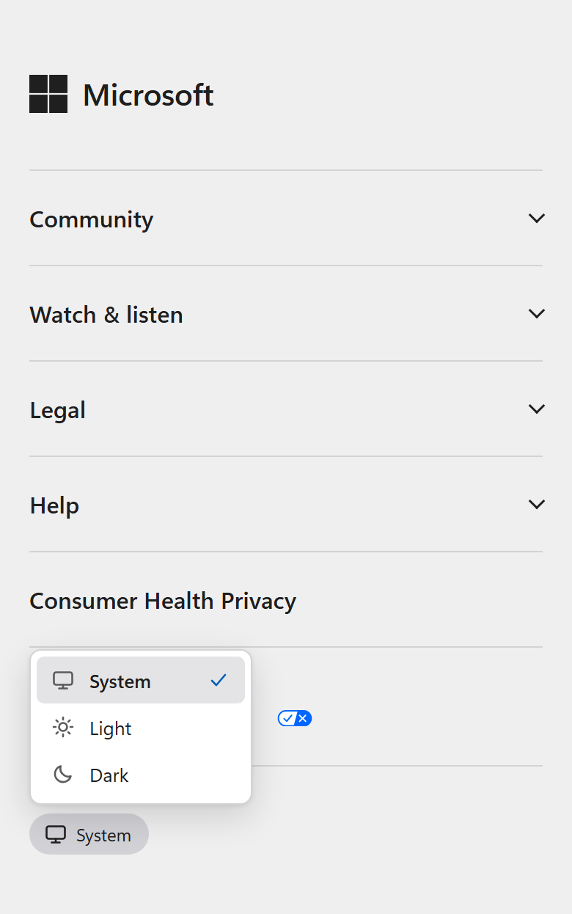

# VS Code website footer

The new footer for the VS Code website (code.visualstudio.com), ready to replace the current one. It has a desktop layout and a mobile layout, takes on the site's own colours and type, and includes a theme menu (System, Light, Dark).

**Replacing the footer with a coding agent?** Point the agent at [AGENTS.md](AGENTS.md). It has step-by-step instructions and a checklist.

| Desktop | Mobile |
| --- | --- |
|  |  |
|  |  |

The footer it replaces: [current footer](images/current-footer.png).

## Viewing

Open `index.html` in a browser. It shows the footer at 1280 px and at 390 px side by side, and the theme menu works in both. No build step or server is needed. Open `footer.html` on its own and resize the window to see the layout switch at 760 px.

## Files

```
footer.html   the footer markup, between FOOTER START / FOOTER END comments
footer.css    all footer styles: colour and font tokens, desktop layout, mobile layout, theme menu
theme.js      the theme menu: saves the choice and applies it
index.html    preview page (desktop and mobile frames); not part of the footer
images/       reference renders of the new footer, and a screenshot of the current one
AGENTS.md     instructions for replacing the current footer on the site
```

`footer.html`, `footer.css` and `theme.js` are the whole footer. Only the theme menu needs JavaScript.

## Design

**Desktop (wider than 760 px)**

- The Microsoft logo and wordmark sit on the left.
- Four link columns sit toward the right:
  - **Community:** GitHub, Reddit, X, Bluesky, LinkedIn
  - **Watch & listen:** YouTube, Podcast, TikTok, Instagram
  - **Legal:** Privacy, Consumer Health Privacy, Terms of Use
  - **Help:** Support, License
- One line runs along the bottom, 112 px below the columns:
  - **Your Privacy Choices** with its official icon on the left
  - the license agreement ("By using VS Code, you agree to its license and privacy statement.") centred
  - the **theme menu** button on the right

**Mobile (760 px and narrower)**

- The logo comes first.
- The four groups become expandable rows, separated by thin rules. They use native `<details>` / `<summary>` elements, so no script is needed.
- **Consumer Health Privacy** and **Your Privacy Choices** follow as their own rows. They are always visible, never inside a collapsed group.
- The theme menu button is the last row, on the left.
- The license agreement line is not shown on mobile.

**Theme menu**

- A button shows the current theme's icon and name. Clicking it opens a menu above it with **System**, **Light** and **Dark**, the current one checked, like the theme menu in the site navigation. On mobile the menu opens from the left edge so it stays on screen.
- System is the default and follows the visitor's OS setting. The choice is saved in the browser and applied before the page paints on the next visit.
- It works with the keyboard: arrows and Home/End move, Enter picks, Escape closes. A click elsewhere also closes it.
- The menu sets the theme for the whole site through `data-theme` on `<html>`. The rest of the site needs dark styles for Dark to change more than the footer.

**Type and colour**

- The footer's background colour and text colour must match the existing website, and it uses the site's font. The agent reads these from the site when it builds the footer (see AGENTS.md, step 2).
- Every colour and the font are tokens at the top of `footer.css`, with dark values beside them. The values there match the mockups and the images in this repo; when the footer goes into the site, they are replaced with the site's own values.
- Sizes are part of the design: column headings are 13 px semibold, links are 13 px on desktop and 14 px inside the mobile groups, and small print is 12 px.
- The Your Privacy Choices icon keeps its official blue and white.

## Before shipping

- **Privacy links stay visible.** Your Privacy Choices (California's CCPA opt-out) and Consumer Health Privacy (Washington's My Health My Data Act) must stay visible on every page and at every width. Keep the official Your Privacy Choices icon unchanged.
- **Agreement line on mobile.** The license agreement line is hidden on mobile by design. Confirm that with Microsoft privacy or legal before launch.
- **Dark theme.** The theme menu only pays off once the rest of the site has dark styles. The dark colours in `footer.css` are placeholders until the site's dark palette exists.
- **Social links.** Check the social URLs against the live footer. Some were written by hand.
